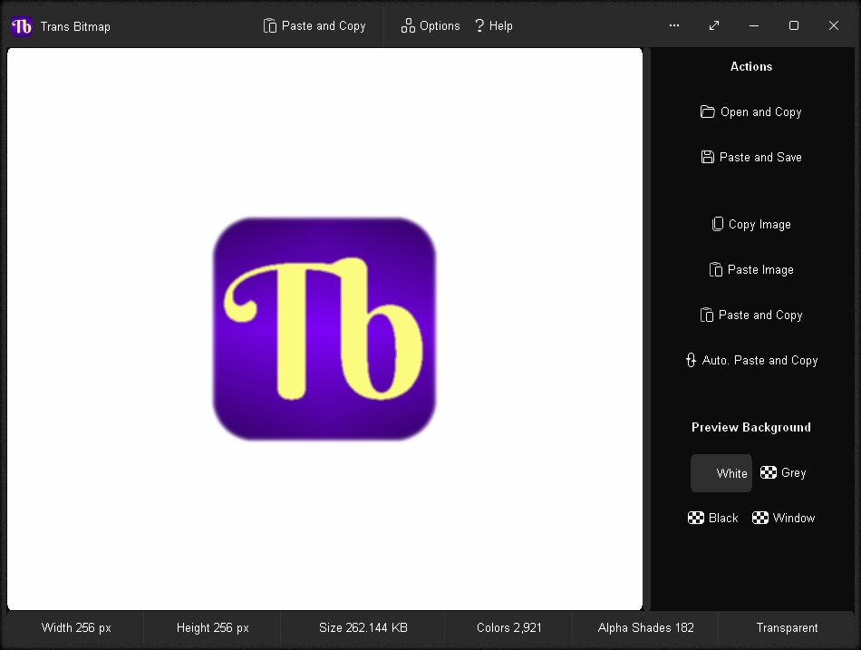
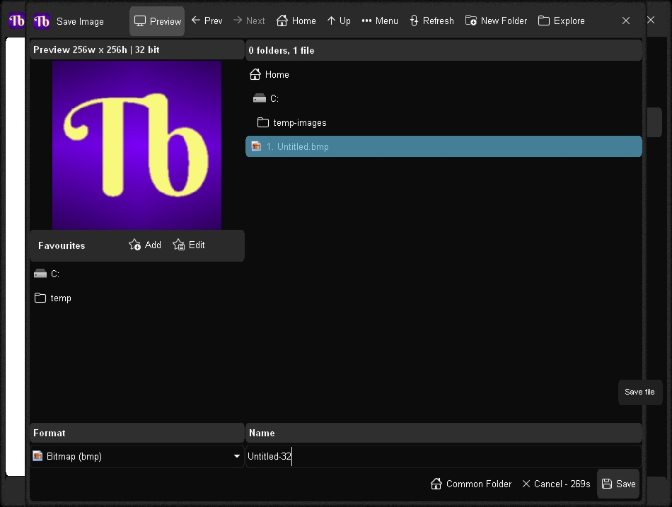

# Trans Bitmap v1.0.192 / 27oct2026 / MIT License
Open, copy, paste, and save legacy 32-bit transparent bitmap images.

Edit your bitmap in a graphics program.  From Trans Bitmap, click the "Open and Copy" button to open, convert, and copy the bitmap to Clipboard.  From your preferred graphics program, e.g Paint.net/Gimp/MS Paint, paste the image from Clipboard and edit.  When done, copy the image back to Clipboard, and click the "Paste and Save" button from Trans Bitmap to save the image to file.

# Features
* Open and Copy - Open image from file, convert for compatibility, and copy image into Clipboard
* Paste and Save - Paste image from Clipboard, convert for compatibility, and save to file
* Copy Image - Convert and copy image to Clipboard
* Paste Image - Paste image from Clipboard
* Paste and Copy - Paste, convert, and copy image to Clipboard for wide app-to-app compatibility
* Auto. Paste and Copy - Automatically perform a paste, convert, and copy operation whenever the image in Clipboard changes, permitting seamless app-to-app copy/paste functionality
* Realtime image preview panel
* Preview background color options: White, grey, black, or window color
* Image details: Width, height, size, colors, alpha shades, and transparent or solid
* Supports opening and saving of 32-bit transparent legacy bitmaps and 24-bit solid bitmaps
* Also supports these additional image formats: ANI, CUR, DIB, GIF, ICO, IMG32, JIF, JPEG, JPG, PBM, PGM, PIC8, PNG, PNM, PPM, SAN, TEA, TGA, TJ32, and XBM
* Options Window - Easily change app color, font, and settings
* Portable
* Smart Source Code (Borland Delphi 3 and Lazarus 2+)

# Download
Download <a href="src/transbitmap.exe">Trans Bitmap.exe</a> or from the "<a href="bin/">bin</a>" or "<a href="src/">src</a>" folders above - for Microsoft Windows, and Linux/MacOS via Wine.

# Images

